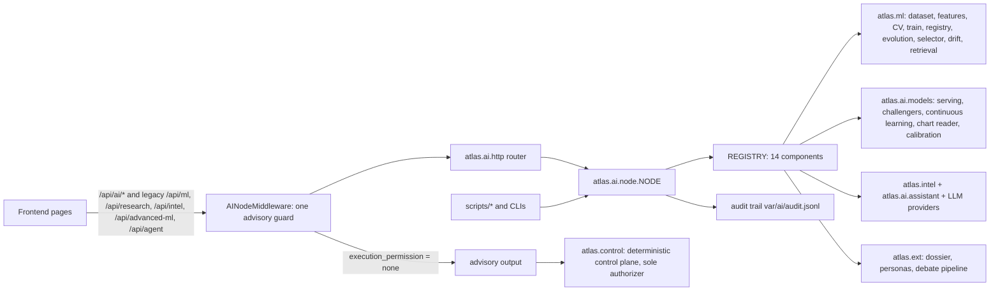

# AI node

All AI/ML/LLM work in ATLAS is one node: the `atlas.ai` package. Consumers (UI, scripts, other packages) go through its facade.

- Facade: `atlas.ai.node.NODE` (`components()`, `status()`, `guard()`), `enforce_advisory()`, `audit()`.
- Statuses: `ok | degraded | unavailable | refused`.
- API: `GET /api/ai`, `/api/ai/status`, `/api/ai/components`, `/api/ai/components/{name}`, `/api/ai/audit`; `/api/ai/<ns>/...` aliases `/api/<ns>/...` (both guarded).
- `execution_permission` is forced to `"none"` in one place (the middleware → `enforce_advisory`), any override is audited. Nothing in the node can authorize an order; only `atlas.control` can.
