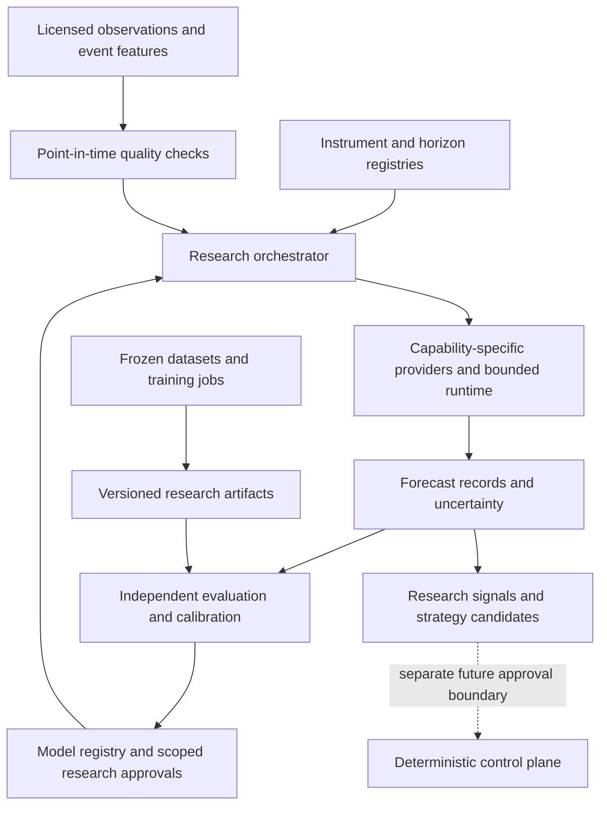

# Universal AI ecosystem architecture

The 2026-10-19 directive expands ATLAS into an extensible research orchestration,
training, evaluation and forecasting platform. It does not assert universal
predictive skill. The user confirmed `C:\Users\borah\ATLAS` as the repository.
No execution engine is present here. Offline research development can proceed;
venue integration and live changes still require their own audit and permissions.

## Implementation boundary

| Area | Implemented now | Integration or validation still required |
| --- | --- | --- |
| Providers | Separate typed research, forecast, prediction, training, embedding, retrieval, registry and deployment protocols; capability discovery | Native adapters for new remote vendors, embedding/retrieval stores and deployment |
| External data / MCP | No MCP client or external data provider is connected | A typed, read-only data-source contract; provider allowlists; licensed source adapters; normalized provenance and quality reports. See [MCP integration review](../research/MCP_DATA_INTEGRATION.md) |
| Existing Gemini | Bridge to existing paid-tier research provider, preferred by discovery | Async-native transport and complete usage metering; no tools enabled |
| Reliability | Async deadline, bounded jittered retries, Retry-After, request/token admission, circuit recovery, per-attempt latency/cost events | Distributed quota coordination, remote cancellation reconciliation, durable telemetry export |
| Instrument/horizon metadata | Immutable versioned records, nine asset classes, session/event/volume/time resolutions, horizon selection constrained by approval/liquidity/cost; session targets can be selected from a supplied schedule when its calendar reference matches | Authoritative venue metadata and calendar data sources/rules; target schedule integration |
| Forecasts | Last-value and zero-return local baselines, scoped approval checks, quality/freshness checks, probability calibration integration, interval metadata, disagreement and research candidates | Licensed real data, statistical intervals where unavailable, validated ensembles, real model adapters |
| Training | Typed jobs/manifests, submission coordinator, ambiguous outcome recording, SQLite experiment history | Real training workers, scheduler, checkpoint storage and provider-enforced spend limits |
| Model lifecycle | Immutable revisions and research-alias rollback in memory or local SQLite | Durable shared registry and authorized deployment workflow |
| Evaluation | Offline metrics, block-bootstrap comparison, probability calibrator, operational metrics | Genuine datasets, preregistered experiments, walk-forward runner and deployment acceptance |
| Whale features | Point-in-time covariates with provenance, licenses and quality | Collectors, entity attribution, event normalization and ablation experiments |

These interfaces do not install PyTorch, tree libraries or foundation weights.
A protocol is not advertised as an operational provider. Read-only health,
fixture-candle, capability and synthetic-demo HTTP routes exist; there is no
forecast, data-ingestion, training, order or funds route, and no automatic cloud
submission. The [research operating contract](RESEARCH_OPERATING_CONTRACT.md)
specifies continuous research and regime requirements; neither is implemented as
a scheduler or regime detector.

## Components and authority

`src/atlas/ai/models/providers.py` uses small Python protocols rather than a giant
base class with unsupported methods. `PredictionProvider` serves local tabular
models and cloud endpoints; location is metadata, not a second incompatible
prediction payload. `TrainingProvider` has submit/status/cancel. Embedding and
retrieval are independent; registry registration is separate from deployment.
Batch forecasting and research streaming are optional protocols. New batch/stream
families should add their own typed contracts, not overload these methods.

`ProviderRegistry` checks advertised core capabilities against protocols. This is
structural validation, not proof of vendor availability. Every native adapter must
also verify its model, region, quota and account settings before advertising a
capability. Vendor support in the research report does not automatically enable an
ATLAS capability. Gemini preference is replaceable configuration policy; it does
not select Gemini for numeric forecasting or allow silent data export to fallback
providers.

## Calls, costs and failure handling

Use one `ProviderRuntime` per provider/account quota scope on one event loop.
Each attempt consumes a rolling request reservation; token-limited operations
require an input-plus-maximum-output reservation. Configure limits from the account,
not the research table. Retry only explicit transient errors on operations marked
safe; permanent validation/auth errors are not retried. Backoff, server Retry-After
and requests share a total deadline. Circuit opening blocks new calls and permits
one recovery probe after cooldown. Client cancellation is not remote job cancellation.

Usage distinguishes reported, estimated and unknown USD costs. Unknown/failed
attempts are counted, not assigned zero cost. The naive provider's zero estimate
means no external invoice; it does not measure electricity or machine depreciation.
Operations reports contain attempt availability and latency percentiles, not a
vendor SLA. Current telemetry lives in memory. No prompt/body/key is logged by
this layer. The legacy Gemini bridge uses a thread and retains its SDK timeout;
an async timeout cannot kill that thread, so avoid stacking retries around it.

## Instruments and horizons

Instrument identity is a versioned ID, not an ambiguous ticker. Metadata carries
venue, asset class, currencies, contract/tick/lot size, margin policy and optional
margin snapshot, calendar version, settlement, data capabilities and permissions.
Options require underlying, expiry, strike and right; dated futures require expiry.
A continuous futures research series is not a tradable contract. `other` requires
explicit research permission. Decimal metadata avoids binary float sizing errors.

Horizon records separate sampling from forecast length: time, event, volume and
session samples; wall/trading/event clocks; direct, recursive, multi-output or
hierarchical methods. Short-term/intraday/swing/long-term are labels, not fixed
seconds. `eligible_horizons` filters scoped approvals against liquidity, cost and
strategy family; `run` additionally validates provider/model/license and data.
Callers supply ordered target timestamps because a calendar service is not yet
implemented. For session horizons, `SessionSchedule` selects future targets from
caller-supplied, versioned schedule data only when its `calendar_ref` matches the
instrument; it does not source or validate exchange rules. The orchestrator checks
target count and freshness; it does not verify exchange holiday schedules or infer
that every market trades continuously.

Compare direct models against recursive error accumulation separately per horizon.
For multi-output forecasts score every lead time and joint interval coverage. For
hierarchical forecasts register aggregation maps and test coherence before enabling
a reconciliation transform. These methods are represented in metadata; this
increment does not pretend to implement a hierarchical reconciliation algorithm.

## Training and reproducibility

Pipeline: ingest with data rights -> freeze and hash content -> point-in-time
features -> chronological train/validation/test split -> train -> calibrate on
validation only -> evaluate untouched holdout -> register immutable challenger ->
independent review -> optional future deployment approval. Artifacts never update
production weights in place.

Dataset manifests include content hash, source and license references, transform
revision, feature lineage and non-overlapping split boundaries. `verify_content`
checks supplied bytes against the frozen content hash. Training requests preserve
code/environment revisions, seed, hyperparameters, method and budget/time ceilings.
SQLite records preserve the exact request and job history across process restarts.
The store is local research bookkeeping, not a multi-tenant production service;
content collection and the build environment must actually match the manifest.

| Pipeline | Method and controls |
| --- | --- |
| Offline supervised | Frozen feature/label matrix; tree or neural worker; chronological split |
| Cloud training | Same manifest; native job adapter; identity-bound storage, region and budget |
| Pretrained inference | Pin weights/license/hash; no training job implied |
| Transfer learning | Explicit pinned base artifact and frozen-layer recipe |
| Fine-tuning | Requires advertised capability plus base revision; Gemini Developer API is not a tuning backend |
| Online features | Update observations/features with availability timestamps; never mutate weights |
| Periodic retraining | Scheduled immutable experiment; all gates rerun; no auto-promotion |
| Ensemble training | Out-of-fold predictions; version members and combiner together |
| Hyperparameter search | Bounded trials and total spend; train/validation only; untouched final test |
| Champion/challenger | Same frozen inputs/cost model; shadow comparison; scoped approval; rollback |

Training submission is not retried automatically. Timeouts/cancellation record an
unknown job state; reconcile using idempotency key before another submission.
Provider adapters must enforce budget/duration ceilings and implement polling and
cancellation. This increment records those limits but has no cloud worker to
meter or terminate. Research alias rollback is implemented in memory and local SQLite with an append-only alias event history; a production
rollback must additionally restore feature, calibrator and environment revisions.

## Forecast processing

Each run checks explicit instrument permission, verified data quality, publication
availability, ordered non-duplicate observations, target times, freshness and
instrument/horizon/target/unit/revision approval. Approval records also constrain
liquidity, costs and strategy family, expire, and identify evaluation evidence and
a human approver. A license check precedes calls. Their references are trusted
local research inputs today; authenticated approval issuance is still required
before any public or production service exposes them.

Responses must match the request identity, exact targets and pinned model. Stale,
future-dated or malformed responses are excluded. Failed providers produce a
rejection; successful providers remain usable. Calls are currently sequential.
The research signal preserves individual forecasts and computes per-target spread when at least two forecasts remain. With fewer forecasts, disagreement is unavailable.
Provider intervals remain labeled with their coverage; missing intervals produce
a warning. Spread is disagreement, not a calibrated uncertainty interval.

Probability calibration uses a versioned held-out binned calibrator with smoothed
rates and minimum bin support. It is bound to instrument, horizon, target, unit and
model revision, and must precede the forecast as-of time. Missing calibration is
explicitly labeled; LLM confidence never enters this path. Calibration quality
still needs out-of-sample Brier/reliability checks and retraining under drift.

No combiner is enabled: `combined_forecast` is null. An ensemble must beat its best
member and naive baseline on independent costed holdouts, preserve error dependence,
and survive an ablation before weights are registered. Candidate strategy names
come only from matching approved research scopes. Every output has
`execution_permission: none`; these candidates are not an instruction to trade.

## Common evaluation plan

The implemented scorer measures MAE/RMSE, naive MAE, return RMSE, directional
accuracy, Brier score when probabilities exist, net expected return, compounded
return, maximum drawdown, 5% expected shortfall and a seeded circular-block bootstrap
interval for paired MAE improvement. No-trade return is zero. Costs are explicit
per-period fractional fees/spread/slippage/funding/turnover, supplied by the caller.
A return at or below -100% requires a separate bankruptcy simulation.

The scorer accepts one instrument/horizon and ordered non-overlapping samples.
The caller must construct non-overlapping holding periods; timestamps alone cannot
prove this. Purge/embargo overlapping labels in walk-forward studies. Bootstrap
block length must reflect dependence; the current interval is exploratory, not a
universal significance test or a multiple-comparison correction. Tiny samples do
not justify promotion. Group reports retain undersized groups as null instead of
silently excluding them.

Publish a matrix by instrument, horizon, regime and dataset. Freeze a second
holdout/market for transfer tests. Compare tree/neural/foundation approaches with
last-value, zero-return, seasonal/statistical and no-trade baselines; the first two
forecast baselines are implemented here, seasonal models remain adapter work.
Track latency, successful-attempt availability, inference/training costs, unknown
costs, licensing references and operational complexity alongside predictive metrics.
A single benchmark or vendor leaderboard cannot establish universal superiority.

## Whale and market microstructure features

Normalize large transfers, exchange inflows/outflows, order-flow imbalance,
liquidity heatmaps, open interest, funding, liquidations, stablecoin flows and
regime labels as covariates. Record event time AND availability time, source,
license, lineage and quality. The request validator rejects future information.
No chain/wallet feature is automatically meaningful for an equity or a forex pair.

Before collection, define attribution confidence, reorg/finality policy, internal
transfer exclusions, unit normalization, deduplication, publication delay and
missingness semantics. Test base versus base-plus-features on identical splits
and costs, with lag and source-drop ablations for each instrument/horizon/regime.
A transfer can be a custody reshuffle, and activity does not guarantee direction.
The current implementation accepts validated feature values; it neither collects
these feeds nor claims they improve performance.
