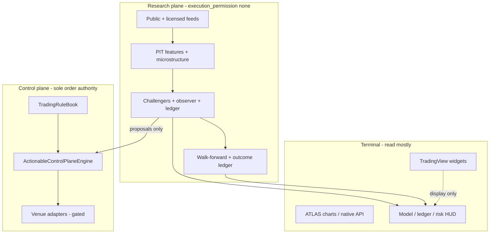

# ATLAS Vision Gap Analysis & Prioritized Roadmap

Verified against `C:\Users\borah\ATLAS-main` on **2026-10-22**. This document maps the 20 master product objectives to repository evidence, separates verified facts from hypotheses, and defines the first implementation milestones.

**Evidence sources:** [CURRENT_STATE.md](CURRENT_STATE.md), [EVIDENCE_ROADMAP.md](../research/EVIDENCE_ROADMAP.md), [EXECUTION_PLAN.md](EXECUTION_PLAN.md), [INTEGRATION_MATRIX.md](INTEGRATION_MATRIX.md), [TARGET_STATE.md](TARGET_STATE.md), live pytest run, frontend typecheck.

---

## Executive summary

ATLAS already has a **credible institutional skeleton**: dual-track (competition vs open-market) research, deterministic `ActionableControlPlaneEngine`, microstructure feature library, walk-forward and outcome-ledger proof paths, live public-data observer, and a unified Next.js terminal. The **control-plane / research air-gap is tested** (`test_architecture_boundaries.py`).

The largest gap is not missing UI—it is **closing the evidence loop**: predictive models on public daily candles do **not** yet beat simple benchmarks ([EVIDENCE_ROADMAP.md](../research/EVIDENCE_ROADMAP.md)). Licensed L2/MBO data, broker sessions, portfolio-level allocation, and multi-user production ops remain **blocked or scaffold**.

**Strategic principle:** Extend proven paths (outcome ledger, live observer, control plane) before adding frameworks or dashboards. No live-money autonomy without explicit approval and passing gates.

---

## Objective mapping (1–20)

| Obj | Theme | Verified today | Gap / risk |
| --- | --- | --- | --- |
| 1 | Real-time market understanding | Coinbase trades + Yahoo daily/minute for 9-name universe; TradingView for display only; live observer on crypto + equity minutes | No Polygon/Databento/IBKR live feeds; equity freshness blocks open-market paper; partial visibility not always surfaced per symbol |
| 2 | Proprietary ML | From-scratch trees/ridge, whale policy walk-forward, online observer (ridge-style), logistic daily-trend ledger | LightGBM/XGBoost/PyTorch not installed; daily ledger **not_supported** on public sample; advanced transformer/drift modules experimental |
| 3 | Whale / microstructure | VPIN, OFI, Kyle λ, Hawkes in `features/microstructure.py`; listings UI hooks | Candle training path **does not observe L2**; whale ML not validated as predictive on live book data |
| 4 | Next opportunity | Chart-read, matrix signals, stance + abstain band, trade-readiness API | Manufactures few actionable stances; costs + calibration gates withhold deployment |
| 5 | Strategy ecosystem | range-garden, reserve-yield (paper), strategy base classes, RL stubs | Most families documented/scaffold only; no validated library with OOS eligibility tags |
| 6 | Prop competitions | Deterministic rulebook in `control/rules.py`, competition track vectors | Firm-specific versioning partial; no funded-firm API; automation permission not modeled per provider |
| 7 | Open-market autonomy | Paper brackets via control plane; connectors (Alpaca, IBKR, CCXT) **blocked** | Live routing disabled; `venue_sessions` = public reads only |
| 8 | Continuous learning | Observer SQLite learning, trial log, walk-forward lab, experiment SQLite | No automated challenger promotion pipeline tied to ledger; no controlled retrain-to-deploy workflow |
| 9 | Simulation / backtest | Purged walk-forward, track paper sim, cost assumptions in ledger/range garden | No full L2 replay; overfitting probability not computed (by design, documented) |
| 10 | Portfolio intelligence | Correlation matrix UI; risk caps in rulebook | Cross-book portfolio view **planned not started** (EVIDENCE_ROADMAP) |
| 11 | Risk authority | `ActionableControlPlaneEngine`; ML `execution_permission: none`; kill switch | **Preserved**—maintain as non-negotiable |
| 12 | Explain decisions | Model path ids, ledger decisions, readiness checks, observer diagnostics | NL interface not wired to validated ops; attribution ≠ causation not always repeated in UI |
| 13 | Unified UX | 6-nav shell, desk/markets/trade/research/data | README vs CURRENT_STATE route counts differ; some legacy routes; complexity in roadmap pages |
| 14 | Research assistant | Gemini scaffold, MCP allowlists, in-app docs | No autonomous deploy; quarantined MCP enforced |
| 15 | Multi-user | RBAC roles in API + frontend context | Clerk/identity not implemented; single-operator desk |
| 16 | Reliability | Stale-data breakers, observer pause on bad input, atomic SQLite commits | No Prometheus/Grafana deployed; DR not tested |
| 17 | Measure success | Outcome ledger, Brier vs 0.25 baseline, trade-readiness | Product metrics for UX/reliability informal |
| 18 | Anti-patterns | Documented in EVIDENCE_ROADMAP, EXECUTION_PLAN | Marketing README still claims some vendors not configured (CURRENT_STATE corrects) |
| 19 | Tech selection | Integration matrix with rejected NC licenses | Avoid installing XGB/LGBM until frozen PIT dataset exists |
| 20 | Evolve repo | This document + execution plan | Incremental milestones below |

---

## Target architecture (coherent destination)

Single-process Python **control + research** (split only when measured), Next.js terminal, three planes:

**Research record flow:** Every forecast → immutable record (model id, dataset, horizon, as-of, track) → scored in ledger → readiness gate → optional human approval → control plane.

---

## Prioritized roadmap (evidence-first)

### Tier 0 — Foundation (now)

| ID | Deliverable | Acceptance criteria | Depends on |
| --- | --- | --- | --- |
| T0.1 | Green **core** pytest + typecheck | ≥300 core tests pass; `tsc --noEmit` clean; experimental ML tests tracked separately | — |
| T0.2 | Single source of truth for **data freshness** | UI + API show source, as-of, stale reason; actions disabled when stale | observer status |
| T0.3 | README/CURRENT_STATE alignment | No claim of connected brokers/data vendors unless configured | audit |

### Tier 1 — Predictive evidence (highest product value)

| ID | Deliverable | Acceptance criteria | Depends on |
| --- | --- | --- | --- |
| T1.1 | **Outcome ledger v2** metrics dashboard | Desk shows ledger verdict, Brier, costed mean, recent 30d window; matches EVIDENCE_ROADMAP numbers | public candles |
| T1.2 | **Frozen PIT dataset** (daily, 9 symbols, 3y) | SHA-256 manifest; purged splits reproducible; fixture excluded from proof | ingest job |
| T1.3 | **Challenger compare** naive vs logistic vs tree (from-scratch or LGBM after legal review) | Beat 0.25 Brier OOS **or** document failure; no promotion | T1.2 |
| T1.4 | **Portfolio correlation view** (two books) | API + panel: correlation, concentration; `execution_permission: none` | ledger returns |

### Tier 2 — Market depth & whale evidence

| ID | Deliverable | Acceptance criteria | Depends on |
| --- | --- | --- | --- |
| T2.1 | Licensed L2 pilot (one symbol) | VPIN/OFI computed on **real** book; labeled vs candle-path features | vendor license |
| T2.2 | Whale event → forward return study | Pre-registered horizon; added to experiment SQLite | T2.1 |
| T2.3 | Listings stream honesty | Partial visibility banner when socket is synthetic around public close | live_stream |

### Tier 3 — Competition & execution (gated)

| ID | Deliverable | Acceptance criteria | Depends on |
| --- | --- | --- | --- |
| T3.1 | Versioned prop rule packs | Provider id + semver; unknown → deny automation | rules engine |
| T3.2 | Paper session adapter (one venue) | Reconciliation tests; no live until audit checklist | credentials |
| T3.3 | Competition progress simulator | Monte Carlo on ledger stats; not profit guarantees | T1.1 |

### Tier 4 — Platform scale

Identity (Clerk), PostgreSQL ops store, Prometheus, multi-tenant isolation, NL copilot bound to read-only tools—**after** T1 proves research value.

---

## Technology recommendations (Obj 19)

| Need | Recommendation | Rationale |
| --- | --- | --- |
| Gradient boosting | **Defer** LightGBM/XGBoost until T1.2 frozen matrix exists | EVIDENCE_ROADMAP; avoid framework sprawl |
| Deep sequence | Keep **observer + from-scratch tree**; PyTorch only if challenger beats trees OOS | TARGET_STATE founder compute |
| Probabilistic TS | Reject TimesFM/Moirai NC weights (already) | INTEGRATION_MATRIX |
| Feature store | DuckDB + Parquet **when** T1.2 lands; fix experimental store before production | feature_store module |
| Charts | TradingView widgets + native public bars; Lightweight Charts when licensed | EXECUTION_PLAN |
| LLM | Gemini research-only, no tools on trade path | architecture boundaries |

---

## First implementation milestone (recommended)

**Milestone M1: “Evidence closure on public data”**

1. Ship **ledger + readiness visibility** on Desk (single panel: verdict, Brier, costed mean, n stances, recent month).
2. Build **frozen daily PIT extract** for the 9-symbol universe with manifest.
3. Run **EXP-002**: challengers on frozen data; append results to trial log without deleting failures.
4. **Do not** enable live trading, new brokers, or auto-promotion.

**Rollback:** Panel is read-only; dataset is additive files; no control-plane rule changes.

---

## Verified vs hypothesis vs assumption

| Statement | Status |
| --- | --- |
| Control plane blocks ML from submitting orders | **Verified** (tests + code structure) |
| Public daily trend ledger fails costed proof today | **Verified** (EVIDENCE_ROADMAP) |
| Live observer learns from real Coinbase/Yahoo inputs | **Verified** (MODEL_RUNTIME_INTEGRATION audit) |
| Observer/daily policy = production trading edge | **Hypothesis — rejected until ledger supports** |
| Microstructure features improve candle-only models | **Hypothesis — requires L2 pilot** |
| Polygon/Databento connected | **Assumption false** (CURRENT_STATE) |
| 168 vs 261 vs 314 test counts | **Environment-dependent**; core suite ~314 passed Oct 2026 after collection fix |

---

## Maintenance

Update this file when: ledger verdict changes, a tier completes, or a vendor session becomes configured. Cross-link experiment ids in `docs/research/experiments/`.
