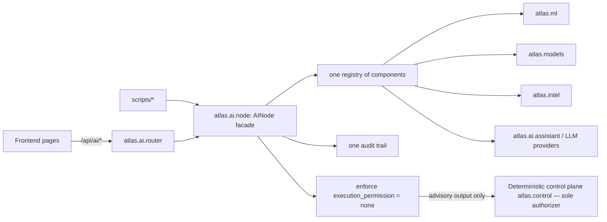

# Repo streamline + AI-as-one-node audit — 2026-10-24

Base: `main` @ 8cea007 (box == GitHub == laptop). Method: scripted scan (`import` of every module in a subprocess, reference grep across src/scripts/tests/tools, AST duplicate-name scan, `--help` on every script, FastAPI route table dump, pytest collect). Read-only on main.

## (a) Completeness

| Check | Result |
|---|---|
| Modules import | 468/470 OK. `atlas.yield` cannot be imported by name (`yield` is a Python keyword → SyntaxError; only reachable via `importlib`). `atlas.ledgers.__main__` is a CLI entry (argparse exit, expected). |
| pytest collect | 1620 tests, 0 collection errors |
| Scripts `--help` | 13/18 OK. **Broken:** `backtester_realism_compare.py` (KeyError `ATLAS_FEED_DB` at import), `fetch_fred_public.py` (does network on `--help`, HTTP 404), `run_e2e_journey.py`, `run_level_research.py` (IndexError on `sys.argv`), `run_selector_evidence.py` (RecursionError) |
| pyproject `[project.scripts]` | all targets resolve (`atlas.ai.cli`, `atlas.control.policy_cli` are only referenced from here — not dead) |
| API routes | 93 route objects; routers: catalog, udf, vertical_slice, founder, founder_data, visuals, quant, ml, agent, console, feeds, intel (`/api/intel`), plus 12 mounts. AI-ish paths are spread across `/api/ml/*`, `/api/research/*`, `/api/advanced-ml/*`, `/api/intel/*`, `/api/agent/*` — no single namespace. |
| Frontend → API | AI calls made from deskPages.tsx (16), IntelViews.tsx (13), MlModels.tsx (6), InstitutionalWorkspacesView, opportunityMarkers, ModelFlowPanel, LiveModelLockPanel, ChartTrainStrip, StreamlinedTradingStudio, WhaleOnChart, ObserverHealthPanel, ChartLockRail |
| Tests per package | untested: `backlog_tracker`, `experiments`, `fundamentals`, `integrations`, `lifecycle`, `main` |
| Docs-only references | `docs/ADVANCED_ML_INFRASTRUCTURE.md` documents `atlas.marketdata.drift_integration` usage that nothing in code calls |

## (b) Streamlining

**Unreferenced modules:** `atlas.research.warmup` (106 lines), `atlas.marketdata.drift_integration` (252 lines, docs-only).

**Committed generated artifacts:** `frontend/build_output.txt`, `frontend/ATLAS_AUDIT.md` (stale audit at wrong level). No `var/`, `.pyc` or db files tracked (good).

**Duplicate public names across packages (47 total; notable):**
- metrics: `brier` in `models.quant.metrics`, `ml.metrics`, `features.price_action.library`; `reliability` in `ml.metrics` and `research.setup_evidence`
- features: `bars_frame` in `models.quant.features` and `ml.features`; `FeatureStore` in `features.feature_store` and `marketdata.pit.featurestore`
- CV: `purged_walk_forward` in `models.quant.cv` and `research.vertical_slice`
- regime: `classify` in `models.serving`, `intel.regime`, `feeds.status`
- feeds clients: `FinnhubAdapter` in `feeds.providers.finnhub` and `marketdata.pit.providers.finnhub`; `ProviderDisabled` ×3; `ProviderRegistry` ×2
- `compute_hawkes_intensity` in `whale_saas_az` and `marketdata.microstructure`; `symbol_info` in `feeds.udf` and `api.udf`
- schemas: `Instrument` ×3, `Bar`/`Candle` ×2, `ProviderInfo` ×2
Many are genuinely different domain objects with the same name; merging is only safe where signatures and math are identical — see Phase 2 notes.

**Oversized files:** `research/vertical_slice.py` 4004 lines, `api/app.py` 3187, `models/challengers.py` 995, `whale_saas_az.py` 981, `control/engine.py` 900 (control plane — not to be touched).

**Deps:** `databento`, `polygon-api-client`, `ccxt`, `polars`, `aiohttp` are declared in pyproject + requirements but never imported (only string literals). `google-genai` is used (lazy import in `ai/gemini_provider.py`).

**Top level:** roadmap xlsx with spaces in name at root (kept — tracked deliverable), root `package.json` is a forwarder (kept). docs/ has 111 files with overlapping architecture docs (`CURRENT_STATE`, `TARGET_STATE`, `UNIFIED_INTELLIGENCE_ASSESSMENT`, `UNIVERSAL_AI_ECOSYSTEM`) and no single index.

## (c) AI inventory

| Component | Location | Entry / API | UI |
|---|---|---|---|
| LLM research provider (Gemini), policy gate, secrets scrub | `atlas.ai` (`provider`, `gemini_provider`, `policy`, `schemas`, `cli`) | `atlas-research` CLI | — |
| Research assistant (BM25 retrieval, guard, tools, store) | `atlas.ai.assistant`, `atlas.ml.retrieval`, `atlas.intel.assistant` | `/api/intel/*`, `/api/agent/*` | IntelViews |
| ML pipeline: dataset, features, CV, costs, calibration, metrics, train, registry, drift, refresh | `atlas.ml.*` | `scripts/ml_refresh.py`, `ml_diagnose.py`, `ml_model_card.py` | MlModels |
| Evolution (genetic search over setups/models) | `atlas.ml.evolution` | `scripts/evolve_models.py` | — |
| Selector / regime classifier, meta-labels | `atlas.ml.selector`, `atlas.models.strategy_classifier`, `technique_selector`, `regimes`, `intel.regime`, `regime.hawkes_detector` | `/api/ml/*`, `/api/research/*` | ModelFlowPanel |
| Model serving / predict / orchestrators | `atlas.models.serving`, `predict`, `orchestrator`, `bot_orchestrator`, `runtime`, `providers`, `registry`, `model_store` | `/api/research/live-predict`, `/api/advanced-ml/*` | LiveModelLockPanel |
| Challengers / transformers / GBDT / whale ML / perfect-trader | `atlas.models.challengers`, `transformer_*`, `microstructure_gbdt`, `whale_*`, `perfect_trader_whale` | `/api/ml/whale-policy/*`, `/api/ml/perfect-trader/*` | WhaleOnChart |
| Continuous / live training / observer / shadow / self-training | `atlas.models.continuous`, `live_training`, `live_observer`, `observer_service`, `shadow`, `self_training` | `/api/ml/live-train*`, `/api/ml/live-observer/status`, `/api/research/continuous-tick` | ObserverHealthPanel, ChartTrainStrip |
| Chart reader / chart policy | `atlas.models.chart_reader`, `chart_policy` | `/api/ml/chart-read` | ChartLockRail |
| Drift | `atlas.ml.drift`, `models.drift_detection`, `marketdata.drift_integration` | `/ws/drift-alerts` | — |
| Uncertainty / calibration | `ml.calibration`, `models.uncertainty_calibration`, `control.uncertainty_gating` | — | — |
| RL agents | `strategies.rl_agent`, `execution.rl_agent` | — | — |
| Intel lab (fourbox, markers, portfolio, microstructure) | `atlas.intel.*` | `/api/intel/*` | IntelViews |
| ext-1 (pending merge): conviction/personas/debate | — | — | — |

`execution_permission` is asserted in ~60 modules independently (each model hard-codes `"none"`); there is no single enforcement boundary.

## Target architecture: AI is ONE node

- Package `atlas.ai` is the node. `atlas.ai.node.AINode` = one registry (`components()`), one serving interface (`invoke(component, op, payload)`), one config, one audit trail (append-only JSONL under `var/ai/audit.jsonl`), uniform statuses (`ok|degraded|unavailable|refused`).
- Every output passes `atlas.ai.node.enforce_advisory()` which forces `execution_permission="none"` and refuses payloads that try to grant anything else. Only `atlas.control` authorizes.
- One API namespace `/api/ai/*` (`/api/ai/components`, `/api/ai/status`, `/api/ai/invoke/{component}/{op}`, `/api/ai/audit`) with existing `/api/ml/*`, `/api/research/*`, `/api/intel/*`, `/api/advanced-ml/*` kept as aliases for one cycle.
- Underlying packages (`atlas.ml`, `atlas.models`, `atlas.intel`) become internal implementations behind the facade; moving them physically is deferred until concurrent branches settle (to avoid churn conflicts), with deprecation notes.

## Pass 1 outcome (branch atlas-unify-1, from main 61e03df after ext-1 + evo-6 landed)

Fixed:
- 5 broken scripts: `--help` now prints usage without side effects; `backtester_realism_compare.py` gives a clear error when `ATLAS_FEED_DB` is unset; `setup_evidence.load_datasets` legacy JSON branch recursed into itself (RecursionError) — now reads `*.json` cache files via `load_bars`.
- AI node: `atlas.ai.node` (registry of 14 components incl. ext-1 conviction/personas/debate, status, audit trail `var/ai/audit.jsonl`, `enforce_advisory`) + `atlas.ai.http` (`/api/ai`, `/api/ai/status`, `/api/ai/components[/name]`, `/api/ai/audit`, and `/api/ai/{ml,research,intel,advanced-ml,agent}/*` aliases). One ASGI middleware guards JSON output of every AI path, old and new, forcing `execution_permission: "none"`; control-plane paths are untouched.
- UI: ML models page now calls `/api/ai/ml/*` and shows an AI node card.

Removed / consolidated:
- `atlas.research.warmup` (106 lines, unreferenced), `atlas.marketdata.drift_integration` (252 lines, docs-only), `frontend/build_output.txt` (63 lines, generated); `frontend/ATLAS_AUDIT.md` moved to `docs/audit/2026-10-21-frontend-audit.md`.
- `brier`: one implementation (`atlas.models.quant.metrics.brier`); `atlas.ml.metrics` and `features.price_action.library` re-export it.
- 5 unused deps dropped from pyproject + requirements (databento, polygon-api-client, ccxt, polars, aiohttp).

Deferred (behaviour-sensitive or not identical): other same-name pairs listed above are distinct objects; physical move of `atlas.models`/`atlas.ml`/`atlas.intel` under `atlas.ai` left for later passes.

## Pass 2 outcome (atlas-unify-2)
- **Duplicate helpers: verdict is homonyms, not duplicates.** Each pair has a different signature and different semantics, so merging them would change results:
  - `bars_frame`: `models.quant.features` returns close/volume indexed by ts; `ml.features` returns full OHLCV with start/end columns.
  - `purged_walk_forward`: `models.quant.cv` is a split generator over timestamps; `research.vertical_slice` is a full candidate-comparison study over FeatureRows.
  - `FeatureStore`: `marketdata.pit.featurestore` is a SQLite point-in-time store; `features.feature_store` is a DuckDB/Parquet versioned store.
  - `compute_hawkes_intensity`: `whale_saas_az` already delegates to `marketdata.microstructure`, so it is a thin adapter.
  - `symbol_info`: `feeds.udf` uses the AtlasFeed instrument registry; `api.udf` uses the desk asset catalog.
  - No change was made. The pairs are recorded here so they are not re-flagged.
- **Untested packages now covered** by `tests/test_untested_packages.py` (8 tests): experiments, fundamentals, main (import only, no start), lifecycle and backlog_tracker. `integrations` is left to the integrations worker.
