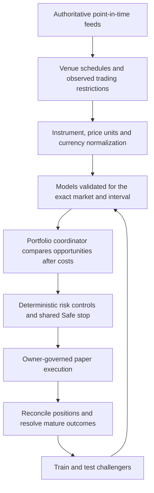

# Global market evolution: evidence and implementation plan

Assessment date: **2026-10-28**, owner timezone **America/Toronto**. Scope: assess the best starting universe for research and unattended paper trading. No live execution or autonomous promotion is authorized by this work.

## Recommendation

Build one portfolio coordinator above market-specific research models. Start with **SPY/QQQ and BTC/ETH**, where the project already has instrument definitions and market history. First establish trustworthy research/shadow results; then admit **one Tokyo equity instrument** as an observation-only overseas pilot, followed by London. Tokyo instruments and their data/broker permissions still need qualification. A calendar entry alone does not qualify them.

The coordinator should consider every admitted market that is usable now. Markets overlap; it should not blindly move capital when another exchange opens, force trades to fill a timetable, or close a good position solely because another market opens. Holding cash and abstaining remain valid decisions. Round-the-clock monitoring and profitable round-the-clock trading are different milestones.



## What the saved models actually show

The inspected `var/ml/registry` contains five fitted versions from **2026-10-27**. All are `not_eligible`; none has passed the project's complete serving gates. They are trained research artifacts, not validated production models. The earlier README's empty-registry statement and the registry guide's production-artifact wording describe different or outdated states.

| Group | Out-of-sample events | Brier skill | Taken setups | Mean net R on taken setups | Status |
|---|---:|---:|---:|---:|---|
| crypto-15m | 10,688 | -0.0042 | 10 | +0.1652 | not_eligible |
| crypto-1h | 4,479 | -0.0056 | 21 | -0.3515 | not_eligible |
| crypto-4h | 793 | -0.0104 | 6 | -0.2039 | not_eligible |
| equity-15m | 558 | -0.0381 | 0 | unavailable | not_eligible |
| equity-1h | 1,245 | -0.0382 | 37 | -0.8621 | not_eligible |

Negative Brier skill means these probabilities did not beat their base-rate benchmark in the recorded evaluation. All five fail the Brier, log-loss, deflated-Sharpe and forward-shadow gates; crypto-4h also fails PBO. The ten selected crypto-15m outcomes are insufficient to establish a reliable profitable strategy. The project's gates in `src/atlas/ai/ml/train.py` include at least 200 OOS events, positive Brier skill, log loss below baseline, DSR above 0.95, PBO below 0.5 and at least four forward shadow weeks. These are project admission rules, not a guarantee of future returns.

The manifests' equity groups include GC and SI labeled as equity. Futures require their own correct instrument classification, costs, multipliers and validation. NQ and ES must not borrow an ETF model merely because both relate to US assets. AAPL/MSFT are also not in the inspected manifests' training series. SOL is covered in the crypto 15m/1h training metadata, but not crypto-4h.

Reproduce the manifest counts, exact versions, metrics and training scope using the JSON snapshot and command below. This assessment did not retrain models or change any eligibility flags.

## Existing foundations and gaps

| Area | Existing code | Practical limit |
|---|---|---|
| Global sessions | `config/founder/schedule.yaml`, `src/atlas/ops/sessions.py`, `src/atlas/marketdata/pit/calendars.py` | Configured markets do not imply instrument coverage, data entitlements or broker access. |
| Shared data | `src/atlas/feeds/`, PIT SQLite store, instrument master | The older `src/atlas/autopilot/feeds.py` still reads Parquet or synthetic replay; reading a file refreshes its health timestamp. |
| Model evidence | `src/atlas/ai/ml/train.py`, `registry.py`, shadow collectors | Five saved meta-models fail admission; multiple older model/serving paths coexist. |
| Live model API | `src/atlas/ai/ml/live_intelligence.py` | Before this change it accepted rejected artifacts and could substitute timeframes or asset classes. Further probability/feature semantics still need repair. |
| Portfolio protection | Deterministic control plane, Safe stop, `src/atlas/risk/engine.py` | Preserve shared exposure limits and the owner's risk-day convention through every market handoff. |
| FX and valuation | `src/atlas/risk/fx.py`, `src/atlas/execution/paper/broker.py` | Static FX defaults and entry-time position FX are unsuitable for current global portfolio valuation. Settlement also needs business-day calendars. |
| Background operation | `src/atlas/ops/runner.py`, jobs, state store, watchdog | `npm run dev` starts the web/API bridge. It does not start a supervised ingest/core/watchdog deployment, and local processes stop during laptop sleep. |
| Learning loop | `src/atlas/ops/runner.py`, separate `var/models` registries | Missing Parquet can trigger synthetic challenger training. Configured calendar refresh lacks a handler; failed job slots are marked before execution. |

## Changes in this pass

1. **Reject unvalidated or out-of-scope live models.** The newer live loader requires `eligible`, nonempty passed gates, the exact asset/timeframe group, and the requested instrument in the corresponding training series. Cached model binaries do not bypass a fresh manifest/scope check. Requested bars keep their actual timeframe. Health distinguishes fitted artifacts from eligible models.
2. **Use exact existing calendar windows.** Continuous windows split around lunch; opens are inclusive and closes exclusive. Next-change times come from actual schedule boundaries. The configured entry cutoff uses the actual final close, including early-close days, and does not invent a daily close for crypto. Missing calendar coverage fails closed. Calendar source/version travels with the read-only plan.
3. **Expose a reproducible assessment.** `scripts/global_market_check.py` combines model manifest evidence and `SessionModel.plan()`. It reads local files only and does not load model binaries or launch any trading worker. Scheduled entry eligibility explicitly excludes broker, feed, model and risk admission.

These changes improve eligibility checks and scheduling. They do not establish better prediction accuracy, a profitable strategy, a current broker connection, or unattended execution readiness.

## How the handoff looks from Toronto

An illustrative weekday sequence around **2026-10-28** is shown below. London and Toronto change daylight saving time on different weekends, so London's opening is 04:00 Toronto on this date. The software must calculate dated schedules rather than retain a fixed local-time table.

| Venue/session | Toronto time for this example | Meaning |
|---|---|---|
| London, Oct 28 | 04:00-12:30 | Research overlaps the US session. |
| NYSE core, Oct 28 | 09:30-16:00 | Existing US ETF research universe. |
| Tokyo morning, Oct 29 local | Oct 28 20:00-22:30 | Observe while the owner may be asleep. |
| Tokyo afternoon, Oct 29 local | Oct 28 23:30-Oct 29 02:30 | Lunch is closed from 22:30 to 23:30 Toronto. |
| Crypto | Continuous scheduled availability | Venue restrictions, liquidity and feed health still control admission. |

NYSE's published core hours are 09:30-16:00 ET. Tokyo publishes 09:00-11:30 and 12:30-15:30 JST; London publishes 08:00-16:30 local. These describe schedules, not instrument-level trading permission. Sources: [NYSE](https://www.nyse.com/markets/hours-calendars), [JPX](https://www.jpx.co.jp/english/equities/trading/domestic/01.html), [LSE](https://www.londonstockexchange.com/en/resources/faqs/personal-investing).

`src/atlas/market/sessions.py` follows Nasdaq's published 23/5 launch: **December 6, 2026 at 21:00 ET**. The 20:00–21:00 ET window stays a closed pause, and Friday after 20:00 stays closed until Sunday 21:00. The founder planner remains a regular-session planner. Source: [Nasdaq trader alert 2026-46](https://www.nasdaqtrader.com/TraderNews.aspx?id=ETA2026-46).

## What “harmonizing pricing” needs to mean

Every observation needs an exchange-qualified instrument ID, asset class, quote currency and unit, lot/tick size, contract multiplier, event/receipt time and provider. Preserve USD versus USDT, GBP versus GBX/pence, cash equities versus CFDs, and actual futures contracts versus continuous chart series. Equal-looking symbols or prices are insufficient identity.

For a cash holding, base-currency value is `quantity * price_in_quote_currency * FX_quote_to_base`; derivatives also require the correct multiplier and contract accounting. For example, a price quoted in GBX must first be converted from pence to pounds. FX must be timestamped and usable at the decision time. Historical macro/reference rates are not executable conversion quotes.

Compare net opportunity and risk in a shared portfolio unit after spread, fees, slippage, conversion costs, liquidity and uncertainty. Buying an unrelated security on another exchange does not continue the same trade. Cross-listed instruments require verified fungibility, conversion ratios, transfer/settlement constraints and synchronized executable prices before any arbitrage claim.

## Admission sequence

1. **Repair the research-serving contract.** Use the same actual confirmed setup/features and target definition in training, replay and inference. The current newer path heuristically chooses a setup and derives up/down/neutral probabilities from one after-cost setup-success score; those are not separately calibrated directional forecasts. `probability_target_before_stop` also needs alignment with the actual trained after-cost-positive target. Do not treat these displays as validated probabilities even after the loader hardening.
2. **Establish the small research baseline.** Use only confirmed PIT data for SPY/QQQ/BTC/ETH. Record data quality, exact training scope, costs, calibrator, all trials and failed gates. Resolve outcomes after their horizons mature. A missing provider or history remains unavailable, never synthetic evidence.
3. **Run the Tokyo observation pilot.** Admit one explicit instrument with verified calendar, source coverage, JPY units/FX and broker contract metadata. Validate holidays, lunch and Toronto/venue date boundaries. Compare a Tokyo-specific model against its own base-rate and take-all baselines before expanding.
4. **Rehearse unattended paper operation.** Connect the paper loop to authoritative feeds; reconcile positions before resuming after restart; enforce shared portfolio limits. Run supervised ingest/core/watchdog services on an always-on host. Exercise disconnections, stale data/FX, clock drift, process crashes, partial fills, duplicate submission prevention and owner alerts. No model may relax controls or reset a Safe stop.
5. **Evolve through challengers.** Retrain on a declared cadence with mature real outcomes, purged walk-forward evaluation/embargo and untouched holdout evidence. Preserve trial counts and costs, then accumulate at least the project's four forward-shadow weeks. Promotion and rollback require explicit governance and a scope-specific model card. A retrain that fails gates is a recorded rejection, not improvement.

Use one portfolio budget across all sessions. Opening Tokyo must not reset losses or create a fresh risk allowance. Existing autonomy and owner approvals continue to apply; this plan does not enable live money movement.

## Reproduce the assessment

From the repository root in PowerShell:

```powershell
.\.venv\Scripts\python.exe -B scripts/global_market_check.py --horizon 24
.\.venv\Scripts\python.exe -B scripts/global_market_check.py --at 2026-10-28T04:00:00Z --horizon 24 --output docs/research/global-market-readiness-2026-10-28.json
```

The saved [JSON snapshot](global-market-readiness-2026-10-28.json) pairs the currently inspected manifests with an explicitly dated illustrative schedule. It is not a historical point-in-time model-registry reconstruction, a current price report, a broker check, or evidence that a bot was running. Returned full session windows may extend beyond the display horizon; transitions are restricted to the horizon. Re-running against another registry or calendar version can change the result.
